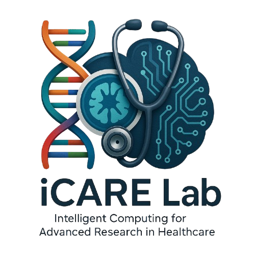

# iCARE Lab — First-Year Scholars Program

### **Intelligent Computing for Advanced Research in Healthcare**
**Kennesaw State University**

---

## 🩺 About the Program

Welcome to the official teaching and research repository for the **iCARE Lab First-Year Scholars Program** at **Kennesaw State University**. 

The **iCARE Lab** (*Intelligent Computing for Advanced Research in Healthcare*) mentors first-year undergraduate scholars from all academic backgrounds—with no prior programming or calculus experience required—through a structured, hands-on journey from **Python fundamentals** to **3D medical image segmentation and clinical AI research**.

---

## 📂 Active Research Cohort & Quick Navigation

| Academic Year | Research Project Track | Interactive Notebooks | Project Folder |
| :--- | :--- | :---: | :---: |
| **2026–2027** | **Exploring AI in Healthcare: 3D Medical Image Segmentation and Analysis** | [**🚀 Open Notebooks Directory**](./2026-2027/Exploring-AI-in-Healthcare/notebooks/) | [**📁 View 2026–2027 Track**](./2026-2027/Exploring-AI-in-Healthcare/) |

---

## 🧭 Two-Semester Training & Research Roadmap (2026–2027)

### 💻 Fall 2026 — Coding & Deep Learning Foundation
Students build a rock-solid foundation in scientific computing and 2D medical imaging through interactive Google Colab workbooks:
* **Python I, II, & III:** Variables, lists, loops, functions, 1D/2D NumPy arrays, region-of-interest (ROI) cropping, binary masks, Matplotlib visualization, and image filtering.
* **PyTorch Intro:** Intuitive linear rules (`y = w * x + c`), PyTorch tensors, forward pass, Mean Squared Error (MSE) loss, automatic differentiation (`.backward()`), and training loops.
* **2D Segmentation I & II:** Linking Google Drive, training a **2D U-Net** on Chest X-Ray lung segmentation datasets, and performing quantitative (**Dice, IoU, Precision, Recall**) and qualitative (**boundary contours & RGB error maps**) evaluation.

### 🔬 Spring 2027 — 3D Medical Image Segmentation & Symposium Research
Students transition to volumetric 3D Computed Tomography (CT/CTA) datasets (**AortaSeg24**, **SEGA/AVT**, **ImageTBAD**, and **BTCV**) and our lab's **AnatoGraph-nnU-Net** framework:
* **Phase 1 (Jan–Feb 2027) — 3D CT Volumes & 3D Slicer:** Loading 3D NIfTI (`.nii.gz`) volumes, millimeter voxel spacing, physical organ volume calculation (mL), Axial/Coronal/Sagittal cross-sections, and interactive 3D Slicer visualization.
* **Phase 2 (Feb–Mar 2027) — 3D Segmentation Pipeline:** Experiencing 3D neural network training on GPU and comparing expert ground-truth annotations against AI-trained 3D models.
* **Phase 3 (Mar–Apr 2027) — AnatoGraph-nnU-Net & 3D Evaluation:** Understanding cross-dataset label sharing (**FCLF**), 3D centerline/surface consistency (**BMGC**), and 23-zone anatomical graph refinement (**CAGR**), alongside 3D Dice, HD95 (mm), and interactive 3D surface rendering.
* **Phase 4 (Apr–May 2027) — Research Symposium & NCUR Preparation:** Generating publication-ready 300-DPI statistical charts, boxplots, and multi-dataset visual galleries for the KSU Symposium and National Conference on Undergraduate Research (NCUR).

---

## 🛠️ Core Tools & Technologies

* **Programming & Deep Learning:** Python, NumPy, SciPy, Pandas, Matplotlib, PyTorch, Google Colab (GPU)
* **Medical Imaging & 3D Visualization:** NIfTI (`.nii.gz`), NiBabel, 3D Slicer, Plotly 3D Mesh Rendering, `nnU-Net v2`, `AnatoGraph-nnU-Net`

---

  <b>iCARE Lab — Intelligent Computing for Advanced Research in Healthcare</b> • Kennesaw State University

